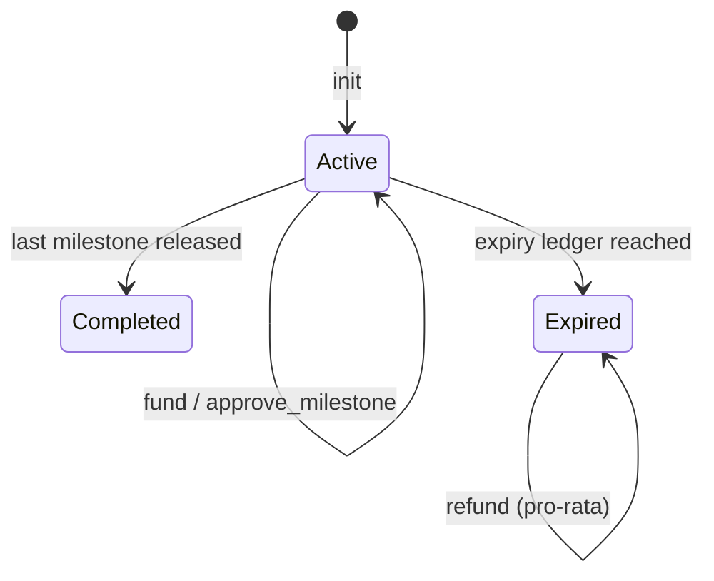

<div align="center">

# ⛪ Antioch Escrow

**A Soroban milestone escrow for transparent giving on Stellar. Donors fund, independent approvers release, unspent funds go back.**

[](https://github.com/YOUR-ORG/antioch-escrow/actions/workflows/ci.yml)
[](LICENSE)
[](CONTRIBUTING.md)
[](https://stellar.org/soroban)

[Design](docs/design.md) · [Security](docs/security.md) · [Antioch App](https://github.com/YOUR-ORG/antioch-app) · [Report a Bug](https://github.com/YOUR-ORG/antioch-escrow/issues)

</div>

---

## About

Antioch Escrow is a smart contract for giving that people can verify. A donor funds an escrow in a Stellar Asset Contract (SAC) token such as USDC. The money is released to a beneficiary one milestone at a time, only after a threshold of independent approvers signs off. If the escrow expires before the work is done, donors can reclaim their share of whatever was not released.

It was built for mission, scholarship and church-project funding, but it is a general "release funds when work is verified" primitive. Any project can reuse it.

This repository is the contract and its TypeScript client. The web platform that uses it lives in [antioch-app](https://github.com/YOUR-ORG/antioch-app).

## ✨ Features

- 🎯 **Milestone releases:** the beneficiary is paid per milestone, not all at once
- 🗳️ **Threshold approval:** M-of-N approvers (for example 2 of 3) instead of one trusted arbiter
- 💸 **Pro-rata refunds:** after expiry, each donor reclaims their share of the unreleased balance
- 🔢 **Integer money only:** `i128` amounts in the token's smallest unit, with no floats and no decimal parsing in the contract
- 📣 **Events:** every fund, approval, release and refund is emitted for indexers
- ♻️ **TTL maintenance:** `maintain_ttl` keeps long-lived escrows from being archived
- 🧰 **TypeScript client:** builds unsigned transactions and reads state; it never touches keys

## 🔄 How it works



1. `init` fixes the beneficiary, token, milestones, approver set, threshold and expiry. None of these can change afterwards.
2. Donors call `fund`.
3. Approvers call `approve_milestone`. When approvals reach the threshold, the milestone is released to the beneficiary automatically.
4. After the expiry ledger, donors call `refund` to reclaim their share of what was never released.

## 📜 Contract interface

| Function | Who | What it does |
|---|---|---|
| `init(approvers, threshold, beneficiary, token, milestones, expiry_ledger)` | deployer, once | Configure the escrow |
| `fund(donor, amount)` | donor | Deposit tokens |
| `approve_milestone(approver, index)` | approver | Record an approval; releases at threshold |
| `refund(donor)` | donor, after expiry | Return the donor's pro-rata unreleased share |
| `state()` · `funded_total()` · `released_total()` | anyone | Read escrow status |
| `milestone(index)` · `milestone_count()` · `approvals(index)` | anyone | Read milestone data |
| `donor_contribution(donor)` | anyone | Read a donor's total contribution |
| `maintain_ttl(start_index)` | anyone | Extend storage lifetime |

Refund math: `refund = contribution × (funded_total − released_total) ÷ funded_total`, using integer division. See [docs/design.md](docs/design.md) for the rounding policy.

## 🚀 Getting Started

### Prerequisites

- Rust (stable) with the `wasm32v1-none` or `wasm32-unknown-unknown` target
- [Stellar CLI](https://developers.stellar.org/docs/tools/cli)
- Node.js 20+ (for the client)

### Build and test the contract

```bash
git clone https://github.com/YOUR-ORG/antioch-escrow.git
cd antioch-escrow
cargo test
stellar contract build
```

### Deploy to testnet

```bash
./scripts/deploy-testnet.sh      # builds, deploys, prints the contract ID
./scripts/demo.sh                # init, fund, approve twice, release
```

**Testnet contract ID:** `TO BE ADDED AFTER DEPLOYMENT`

### Use the TypeScript client

```ts
import { EscrowClient, toStroops } from "@antioch/escrow-client";

const escrow = new EscrowClient({ contractId, rpcUrl, networkPassphrase });

// Build an unsigned transaction. Your wallet signs it, not this library.
const { xdr } = await escrow.buildFund({
  donor: donorPublicKey,
  amount: toStroops("25.0000000"),
});
```

## 🧪 Testing

```bash
cargo test                 # contract: threshold logic, refunds, invariants
cd client && npm test      # client: amount helpers and XDR building
```

The test suite covers every invalid `init` case, funding by several donors, threshold and duplicate-approval rules, release blocked by insufficient funds, double-release and double-refund protection, and a randomized invariant that the contract never pays out more than it holds.

## 🔐 Security

- The contract never custodies keys and the client never signs.
- Approvers are a fixed set. A single compromised approver cannot release funds unless the threshold is met.
- Read [docs/security.md](docs/security.md) for the threat model and known limitations. **This contract has not been formally audited. Do not use it with real funds without an independent review.**

## 🤝 Contributing

Pull requests target `main`. CI (format, clippy, tests, build) must pass. Please open an issue before starting substantial work. See [CONTRIBUTING.md](CONTRIBUTING.md).

## 📜 License

[MIT](LICENSE) © Antioch
